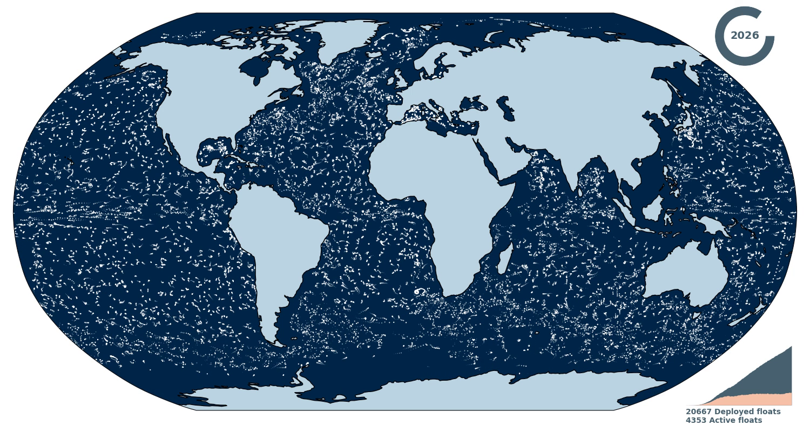

# Argo Floats Animation

Animated world map of the Argo float network, from the first profile to today.



Example video: [output/Argo_floats_ALL.mp4](output/Argo_floats_ALL.mp4)

Everything comes from the profile index files of the Argo Global Data Assembly
Center (date, latitude and longitude of every profile).

| Mode | Floats shown | Index file |
|---|---|---|
| `MODE = 'ALL'` | All Argo floats, core and BGC | `ar_index_global_prof.txt` |
| `MODE = 'BGC'` | BGC floats, optionally restricted to the profiles measuring given parameters | `argo_bio-profile_index.txt` |

## Requirements

```
pip install numpy pandas matplotlib cartopy tqdm imageio-ffmpeg
```

`imageio-ffmpeg` provides ffmpeg for the MP4 output. A system ffmpeg also works.

## How to use it

Edit section 1 of `argo_floats_animation.py`, then run the script:

```
python argo_floats_animation.py
```

The index file is downloaded from the Ifremer FTP server on the first run (130 to
320 MB), then only when a newer version is available.

The main parameters are:

| Parameter | Role |
|---|---|
| `MODE`, `BGC_PARAMETERS` | Floats to show, e.g. `MODE = 'BGC'` and `BGC_PARAMETERS = ['CHLA', 'BBP700']` |
| `INDEX_DIR`, `OUTPUT_DIR`, `OUTPUT_NAME` | Input and output paths |
| `OUTPUT_FORMATS` | `'mp4'` and/or `'gif'` |
| `FPS`, `STEP_DAYS_START`, `STEP_DAYS_END` | Video speed. A lower `STEP_DAYS_END` slows the animation down towards the end |
| `TRAIL_DAYS`, `ACTIVE_DAYS` | Fading of the profiles and definition of an active float |
| `PREVIEW_DATE` | Saves one PNG of this date instead of rendering the video |

## How floats are counted

- **Deployed**: floats whose first profile in the index is older than the current
  date. The date of the first profile stands in for the deployment date.
- **Active**: floats with at least one profile during the last `ACTIVE_DAYS` days.

With `MODE = 'BGC'` and no parameter filter, the counts include every float that has
a B-file, including those measuring only oxygen.

## Data

The animation uses Argo data.

> These data were collected and made freely available by the International Argo
> Program and the national programs that contribute to it (https://argo.ucsd.edu,
> https://www.ocean-ops.org). The Argo Program is part of the Global Ocean Observing
> System.

Argo (2000). Argo float data and metadata from Global Data Assembly Centre (Argo
GDAC). SEANOE. https://doi.org/10.17882/42182

## License

The code is released under the [MIT License](LICENSE). It does not cover the Argo data.
